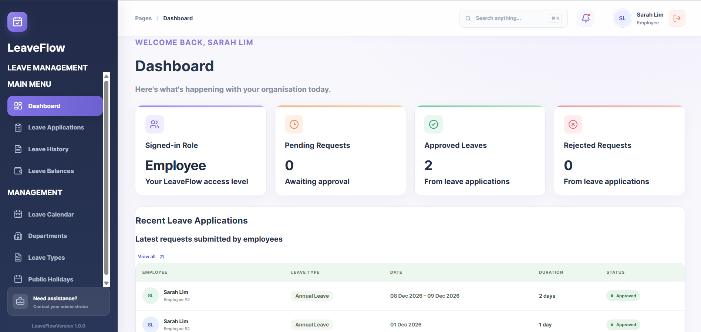
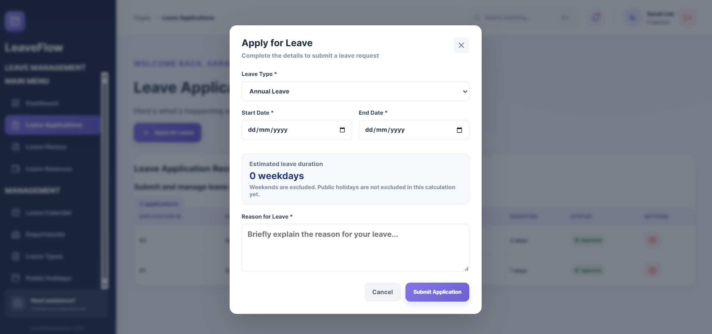
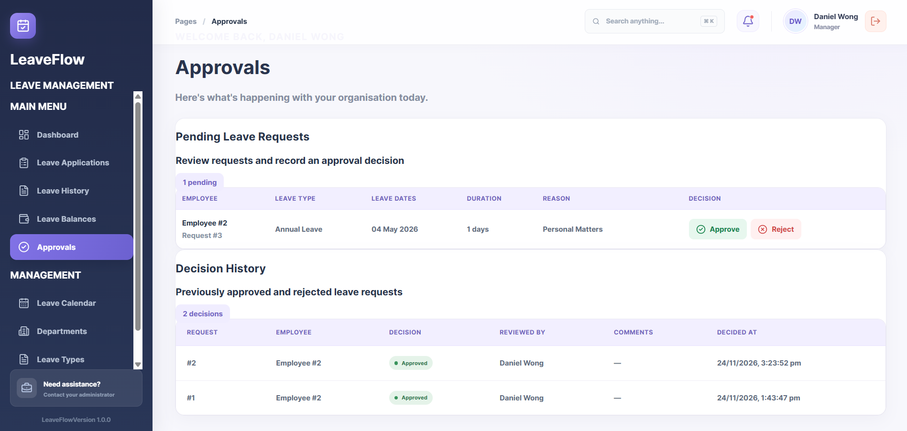
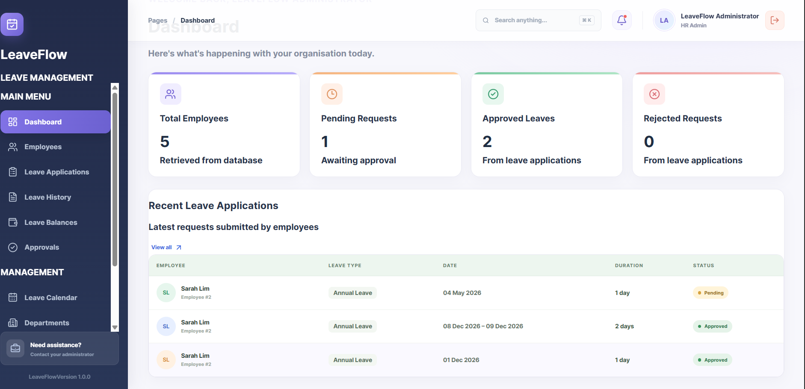

# LeaveFlow
### Employee Leave Management System

A web-based employee leave management platform designed to simplify leave applications, approval workflows, and workforce leave administration.

---

## Project Overview

LeaveFlow provides a centralised platform for managing employee leave with three role-based user types:

- **Employee:** Submit leave applications, view leave balances, and track application status.
- **Manager:** Review employee leave requests and approve or reject applications.
- **HR Administrator:** Manage employee records, departments, leave types, leave balances, and organisation-wide leave information.

## Project Demo

🎬 **Video Demonstration:** [Watch LeaveFlow on YouTube](https://youtu.be/NsCg8v3QVdU)

🌐 **Live Application:** [https://leaveflow-1.onrender.com/](https://leaveflow-1.onrender.com/)

## Application Screenshots

### Employee Dashboard


### Leave Application


### Manager Dashboard


### HR Administrator Dashboard


### Employee Management


## Key Features

### Employee Module
- Submit leave applications.
- View available leave balances.
- Track leave application status.
- View personal leave records.

### Manager Module
- View employee leave requests.
- Approve or reject leave applications.
- Review team leave information.

### HR Administrator Module
- Manage employee records.
- Manage departments.
- Configure leave types.
- Create and manage employee leave balances.
- View organisation-wide leave information.
- Access audit logs.

### System Features
- Role-based access control.
- Centralised leave management.
- Leave balance calculation.
- Leave application and approval workflow.
- Dashboard views based on user roles.

## Technology Stack

| Component | Technology |
|---|---|
| Frontend | React + Vite |
| Backend | Python + FastAPI |
| Database | PostgreSQL |
| Database Hosting | Neon |
| Deployment | Render |
| Version Control | Git + GitHub |
| API Testing | Postman |
| Development Environment | Visual Studio Code |

## System Workflow

1. Employees log in and submit leave applications.
2. Managers review pending applications.
3. Managers approve or reject leave requests.
4. Employees can view their application status and updated leave balances.
5. HR administrators manage employee information and leave administration.

## Project Outcomes

The following results were obtained through individual timed comparisons between manual processes and LeaveFlow:

| Process | Manual Process | LeaveFlow |
|---|---:|---:|
| Leave application submission | 5–7 minutes | 34 seconds |
| Leave approval | 2 minutes | 5 seconds |
| Leave balance retrieval | 3 minutes | 3 seconds |

*These results are based on individual timed tests and are illustrative rather than production-wide benchmarks.*

## Project Structure

```text
LeaveFlow/
├── frontend/
├── backend/
├── screenshots/
│   ├── 01_environment_setup/
│   ├── 02_system_design/
│   ├── 03_backend/
│   ├── 04_application_demo/
│   ├── render_backend.png
│   └── render_frontend.png
└── README.md
```

## Project Status

**Completed Portfolio Project**

This project demonstrates practical experience in:

- Full-stack web application development.
- REST API development.
- Relational database integration.
- Authentication and role-based access control.
- Workflow automation.
- Database management.
- Application deployment using Render.

## Author

Developed as a personal software development portfolio project.